# Hey there 👋, I'm Kartik

## Bio

Software Engineer with experience in Java, Spring Boot, and cloud-native application development. 🚀

Specializing in Java/Spring frameworks and robust REST API development, I have a proven track record in legacy migrations, system performance tuning, and scalable microservices architecture. I have strong foundational roots in Agile methodologies, Test-Driven Development (TDD), and cloud-native technologies.

---

### ✨ Random Dev Quote

---

### ⚡ Github Stats

### ☄️ Github Streaks

